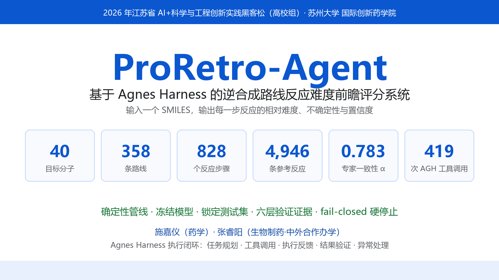
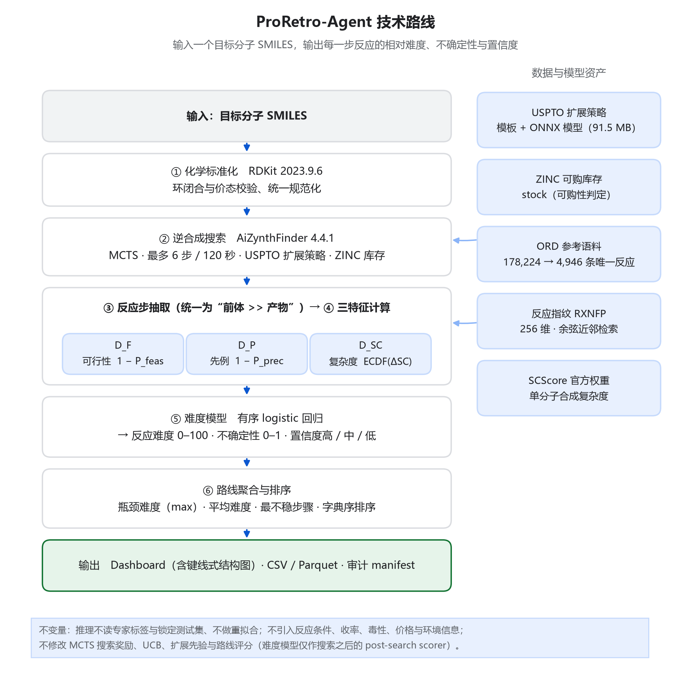
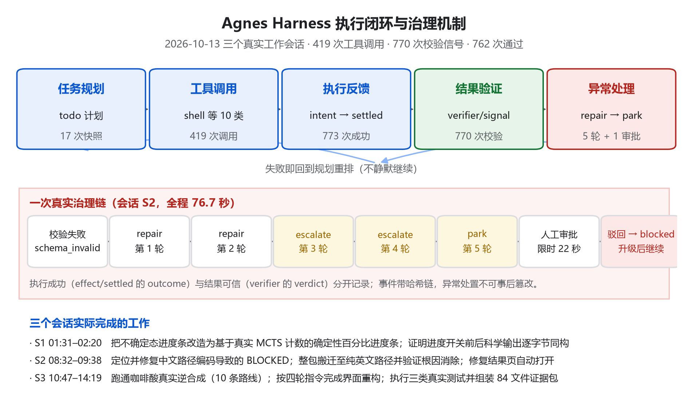
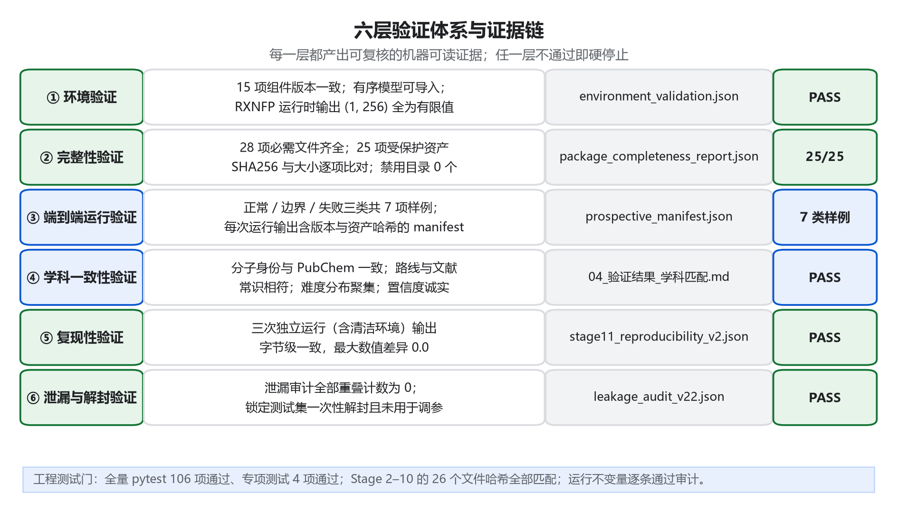
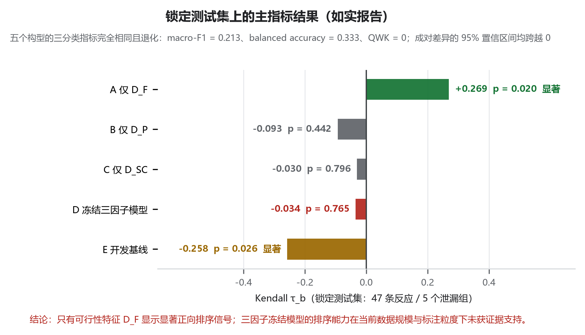

# 给逆合成路线排个"难度"：ProRetro-Agent 的完整实践（附可复现方式）

> 2026 年江苏省 AI+科学与工程创新实践黑客松（高校组）参赛作品 · 苏州大学 国际创新药学院 · 施嘉仪、张睿阳

## 摘要

逆合成工具能给出很多条路线，却回答不了实验室最关心的问题：**哪条路线值得先做？每一步反应相对有多难？** 我们做了一套系统 ProRetro-Agent：输入一个目标分子的 SMILES，它自动完成逆合成搜索、反应步骤抽取、三个化学特征的确定性计算、有序回归难度推断与路线排序，并输出每一步反应的**相对难度（0–100）、不确定性（0–1）与置信度（高/中/低）**。全部智能体执行由 Agnes Harness 完成；科学侧的定义、特征顺序、模型、阈值与排序规则全部冻结并受 SHA256 保护。

## 一、问题从哪里来

同一个目标分子通常有多条可行路线。AiZynthFinder 这类工具基于公开的 USPTO 反应模板与 ZINC 可购化合物库，用蒙特卡洛树搜索（MCTS）枚举路线，并给出"是否可解"与 state score 排序。但 state score 描述的是**搜索策略对节点的偏好**，不是**化学反应在实验室里的实施难度**。

已有的分子级指标（例如 SA score）刻画的是"一个分子整体是否难合成"，自变量是分子；我们需要的是"前体到产物这一步有多难"，自变量是反应。两者不是同一个对象，直接搬用会系统性错配。

更现实的一条约束来自我们自己的条件：作为本科团队，我们不可能对每条路线逐一做条件筛选。于是问题被收敛为——

> **在实验条件未知的情况下，能否借助反应可行性、历史先例与结构复杂度变化，为每一步反应给出具有化学意义、可复现、可审计的相对难度排序，并让结论的强度与证据强度相匹配？**

## 二、我们怎么定义"反应难度"

三个预测因子，每个回答一个"为什么难"：

| 因子 | 定义 | 含义 |
| --- | --- | --- |
| 可行性难度 D_F | D_F = 1 − P_feas | 模型认为该转化是否合理 |
| 前例难度 D_P | P_prec = S_max · (1 − e^(−N_analog / N0))，D_P = 1 − P_prec | 是否有足够多相似的已报道反应 |
| 复杂度增量 D_SC | ΔSC = SC(产物) − max(SC(前体))，D_SC = 经验分布(ΔSC) | 这一步把结构复杂度提升了多少 |

三个输入进入**有序 logistic 回归**（statsmodels `OrderedModel`），得到三级概率后换算为连续难度：D_reaction = 50 · P_medium + 100 · P_difficult。同时输出解析式不确定性 U = [4·P_feas·(1−P_feas) + (1−P_prec)] / 2，并按开发集分位阈值（q33 = 0.3005、q67 = 0.5007）给出高/中/低置信度。

*图 1　技术路线：数据与模型资产、六步确定性流程、三个预测因子与输出对象*

## 三、三个刻意的设计决策

**① 可行性只作后验特征，不在搜索中剪枝。** 如果让快速过滤模型在 MCTS 过程中删掉低分节点，后续所有难度分析都建立在被预先筛过的候选集上，产生选择偏倚。所以研究配置让搜索自由展开，把可行性概率留到评分阶段当特征——两套配置的差异被显式记录。

**② 先例支持要求"高相似 × 多先例"。** P_prec 采用饱和形式：相似度越高起步越高，但只有相似反应足够多才趋近 1。一个相似度 0.95 但只有 1 条先例的转化，其支持度远低于相似度 0.95 且有数十条相似底物先例的转化。

**③ 复杂度用增量、归一化用经验分布。** ΔSC 取产物与最复杂前体之差（用 max 而非 sum，避免前体数量干扰），再用参考语料上的经验累积分布映射到 0–1。相比人为设定区间，经验分布不需要外部假设。

数据规模：40 个目标分子 → 358 条路线 / 828 个反应步骤 / 537 个唯一反应；参考语料取自 Open Reaction Database 官方发布（178,224 条输入 → 规范化去重后 4,946 条唯一反应，许可见 CC-BY-SA-4.0）。

## 四、让"难度"可信：专家标注与冻结

难度不能由我们几个学生拍脑袋定义，所以我们做了三件事：

1. **盲化标注**：按三个特征的三分位做 3×3×3 分层抽样取 300 条反应，交由 3 位标注者独立标注（模板只显示反应式与结构，难度字段一律不可见，呈现顺序各自随机），共 900 条评分；
2. **一致性检验**：序数 Krippendorff α = 0.783（有效 291 条），完全一致 129 条、需仲裁 171 条、弃权 9 条；
3. **冻结与锁定**：按反应级泄漏组做分层分组五折划分（随机种子 42），开发集 244 条、锁定测试集 47 条；三层重叠计数均为 0；锁定测试集**只解封一次**，且从未用于拟合、特征选择、阈值选择、不确定性校准或超参选择。

## 五、Agnes Harness 执行闭环：419 次工具调用与一次 76.7 秒的治理链

按赛事要求，作品以 Agnes Harness（AGH）作为智能体运行与执行底座。在 2026-10-13 的三个真实工作会话中，AGH 累计执行 **419 次工具调用**（其中 shell 202 次）、产生 **770 次校验信号**，并完整记录了计划、调用、反馈、校验与异常处置。

*图 2　Agnes Harness 执行闭环与治理机制：五个环节、一次真实治理链与三个会话的实际产出*

最有说服力的一段过程是**中文路径导致 BLOCKED 的根因定位与修复**：

- AGH 先输出 8 项计划，并把"确认可修改范围"单列一项——先确认启动脚本不在哈希清单内、冻结科研文件不可动；
- 用 shell 读取失败现场，提取到 `UnicodeDecodeError: 'gbk' codec can't decode byte 0xae in position 398`；
- 设计"唯一变量"对照实验：同一份 YAML，不设编码变量时 100% 失败，设 `PYTHONUTF8=1` 时 `RESULT: loaded OK`；
- 根因：AiZynthFinder 4.4.1 以进程区域编码（中文 Windows 为 cp936/GBK）读取含中文绝对路径的 UTF-8 配置；
- 只修改三个启动入口脚本加入编码护栏，修复前失败的甲醇、乙醇、阿司匹林全部通过，并验证变量沿 cmd → PowerShell → GUI → 评分器 → AiZynthFinder 五级子进程逐级继承；
- 回归：25 项受保护资产 SHA256 全部匹配、0 错误，证明冻结资产未被改动；
- 兜底：进一步把整包搬迁到纯英文路径，并在**不设该变量**的情况下再跑一次端到端，证明根因消除。

AGH 还把"执行成功"（outcome）与"结果可信"（verdict）作为两个独立维度记录：本次就出现过执行成功但校验失败的情形，系统没有当作成功继续，而是触发了 5 轮修复决策（repair → repair → escalate → escalate → park）与一次限时 22 秒的人工审批，全过程 76.7 秒，最终以 blocked 结束本轮并升级模型继续——**已完成的真实工作没有被抹掉**。

## 六、验证：六层证据链，和一个诚实的负面结果

*图 3　六层验证体系与证据链*

- **环境**：15 项组件版本与部署清单一致；有序回归模型可导入；独立反应指纹运行时输出 (1, 256) 全为有限值；
- **完整性**：28 项必需文件齐全；25 项受保护资产 SHA256 与大小逐项比对（25/25 匹配）；
- **端到端**：正常/边界/失败三类样例（咖啡酸 10 条路线 PASS、甲醇 0 步路线 PASS、`min_routes=0` 与非法参数 BLOCKED、非法 SMILES 退出码 1）；
- **学科一致性**：咖啡酸分子身份与 PubChem 一致、一步路线与文献常识相符、难度分数同区间聚集、置信度诚实标注为 low；
- **复现性**：三次独立运行（含清洁环境）输出字节级一致，最大数值差异 0.0；
- **泄漏与解封**：重叠计数全部为 0，锁定测试集一次性解封且未用于调参。

**必须如实说明的是：在 47 条锁定测试样本上，只有"仅用 D_F"的单因子模型达到了统计显著的正向排序相关（Kendall τ_b = +0.269，p = 0.020），而我们冻结的三因子模型为 −0.034（p = 0.765，不显著），五个构型的分类指标完全相同且退化。**

*图 4　锁定测试集上的主指标结果：仅 D_F 单因子显著，三因子冻结模型未获证据支持*

我们没有把这条结果包装成"模型有效"。它说明在当前数据规模与标注粒度下，三因子模型的排序能力尚未获得证据支持。因此作品的定位是"**相对难度的探索性排序 + 不确定性门控**"：所有输出都附带不确定性与置信度分档，低证据样本被明确标注为 low；任何不可解释的失败都按硬停止规则中断并写出 blocker，不允许用替代模型或随机权重绕过。

## 七、怎么复现

- **运行方式**：双击 `启动_可运行作品.cmd` 打开图形界面（输入 SMILES 与 Target ID，设置搜索轮数/时间/步数/路线数后运行）；或使用命令行入口；也可直接查看已归档的示例结果 Dashboard（内联 RDKit 键线式结构图）。
- **环境**：Python 3.10.20、AiZynthFinder 4.4.1、RDKit 2023.9.6、NumPy 1.26.4、pandas 2.3.3、statsmodels 0.14.4、scikit-learn 1.5.2、ONNX Runtime 1.23.2；独立反应指纹运行时 Python 3.8.20 + rxnfp 0.1.0。全部推理在 CPU 完成，不需要 GPU。
- **自检前置**：先运行 `package_completeness_test.ps1`，必须同时得到完整性报告与环境验证报告均为 PASS 才继续。
- **数据与组件**：USPTO 公开模型与模板、ZINC 库存、Open Reaction Database（CC-BY-SA-4.0）、SCScore 官方权重、RDKit、AiZynthFinder、statsmodels；来源、版本与哈希均记录在 manifest 中。

## 八、我们学到了什么

1. **"不做什么"比"做什么"更重要。** 我们主动放弃了条件预测、收率预测与毒性评估——因为在候选转化生成时这些标签并不存在，强行预测只会把误差传播到结论里。
2. **验证要设计成门槛，而不是声明。** 冻结哈希、一次性解封、泄漏审计、消融与敏感性分析、fail-closed 硬停止，让"模型是否可信"变成一个可以执行的动作。
3. **诚实的负面结果也是结果。** 只有把不显著的结论原样报告出来，附带的置信度分档才有意义。
4. **智能体需要治理，而不只是能力。** 计划、校验、修复升级与人工审批闸门，让 AGH 的三小时执行过程可复核、可追责。

---

**团队**：施嘉仪（苏州大学 国际创新药学院 · 药学 · 本科）· 张睿阳（苏州大学 国际创新药学院 · 生物制药（中外合作办学）· 本科）

**第三方素材**：本作品使用 AiZynthFinder、RDKit、statsmodels、scikit-learn、ONNX Runtime 等开源软件，以及 USPTO 公开模型与模板、ZINC 库存、Open Reaction Database（CC-BY-SA-4.0）、SCScore 官方权重等公开数据；均以依赖或调用方式使用，未修改第三方源码，未重新分发受限数据。

**标签建议**：#AI4S #逆合成 #药物化学 #Agent #AgnesHarness #可复现研究

---

## 仓库材料索引（赛事要求六项 · 全部公开）

| 目录 | 对应材料 | 内容 |
| --- | --- | --- |
| [`第一项/`](第一项) | ① 项目说明 | 项目说明（Word/PDF，九章 19 页，含 4 张自制图）与可编辑源文件 |
| [`第二项/`](第二项) | ② 可运行作品 | 原创代码、冻结科研资产、启动与自检脚本、依赖锁定与环境重建脚本、部署与使用说明 |
| [`第三项/`](第三项) | ③ 演示视频 | 4 分 53 秒实操演示（1080p，含任务输入、执行、外部能力调用、反馈纠错、结果验证与异常处理） |
| [`第四项/`](第四项) | ④ 运行与验证证据 | 任务执行记录、工具与设备调用链、正常/边界/失败三类样例、学科匹配验证、85 文件 SHA-256 索引、Agnes Harness 执行闭环证据 |
| [`第五项/`](第五项) | ⑤ 成员分工与独立声明 | 每名成员的实际工作明细、第三方素材来源，以及全体成员签署页 |
| [`第六项/`](第六项) | ⑥ 公开成果内容 | 本页正文与配图、发布证据与链接（本文即公开发布载体） |

**本仓库未包含**运行时环境（`frozen_project/.conda-rxnfp/`，1.66 GB）与第三方公开数据（`external_public_data/`，1.40 GB，其中 ZINC 库存受其许可约束不可再分发）；二者的重建与获取方式见 [`第二项/README_本项说明.md`](第二项/README_本项说明.md)。

---

**公开发布日期**：2026-10-14 · **仓库链接**：https://github.com/stieveyang-ops/-
